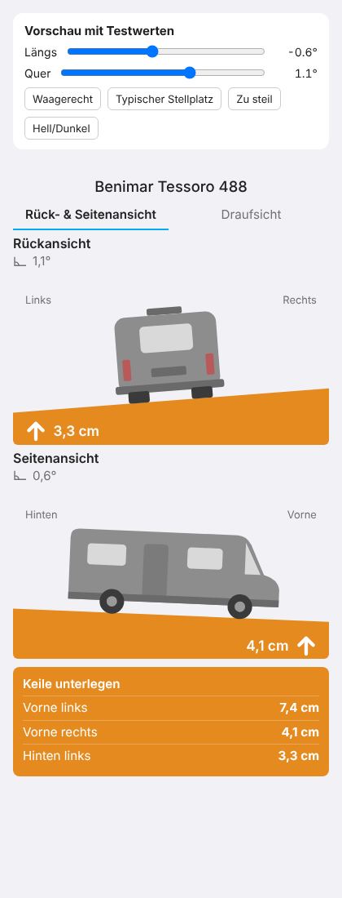
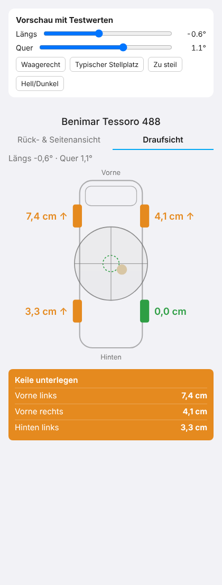

# Digitale Wasserwaage für das Wohnmobil – Home Assistant

Eigene Lovelace-Karte für Home Assistant, die zeigt, wie schief das Wohnmobil steht
und **wie viele Zentimeter Keil unter welches Rad** gehören.

Fahrzeug: Benimar Tessoro 488 (Ford Transit, Radstand 395 cm).

| Rück- & Seitenansicht | Draufsicht |
|---|---|
|  |  |

## Funktionen

- **Rückansicht** (Querneigung) und **Seitenansicht** (Längsneigung): Boden kippt mit, Zentimeter und Pfeil an der tiefen Seite
- **Draufsicht**: Keilhöhe für jedes der vier Räder plus Libellen-Blase
- Liste „Keile unterlegen“, sortiert nach Höhe
- Farben: grün = waagerecht, orange = Keile nötig, rot = höher als die Keile reichen
- Nur „anheben“ (Nivellieren mit Keilen)

## Status

- [x] Dashboard-Karte (`womo-level-card.js`)
- [x] Vorschau mit Testwerten (`vorschau.html`)
- [ ] ESPHome-Konfiguration (ESP32 + MPU6050, Kalibrier-Taste)
- [ ] Installationsanleitung

## Karte konfigurieren

```yaml
type: custom:womo-level-card
title: Benimar Tessoro 488
pitch_entity: sensor.womo_level_neigung_laengs   # + = Front höher
roll_entity: sensor.womo_level_neigung_quer      # + = rechte Seite höher
wheelbase: 395      # cm
track: 170          # cm, Spurbreite – noch nachmessen
tolerance: 0.3      # Grad, gilt als waagerecht
max_wedge: 10       # cm, höchste Keilstufe
min_lift: 0.5       # cm, kleinere Werte ignorieren
exaggerate: 4       # Neigung im Bild übertreiben
bubble_range: 3     # Grad bis Blase am Rand
invert_pitch: false
invert_roll: false
```
