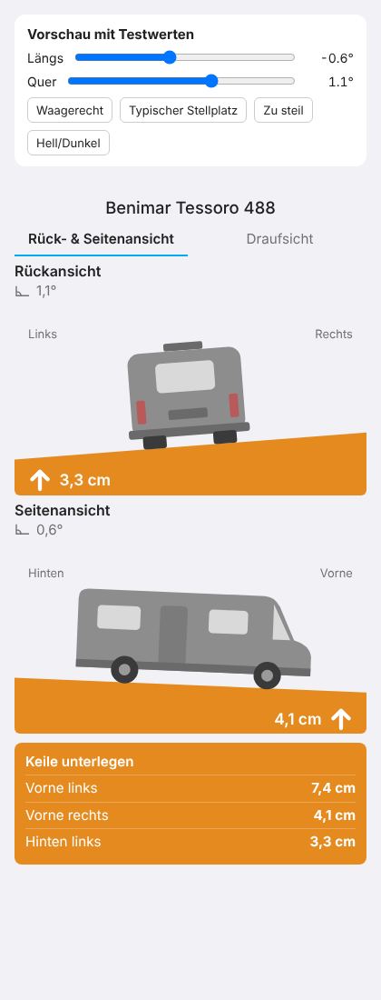
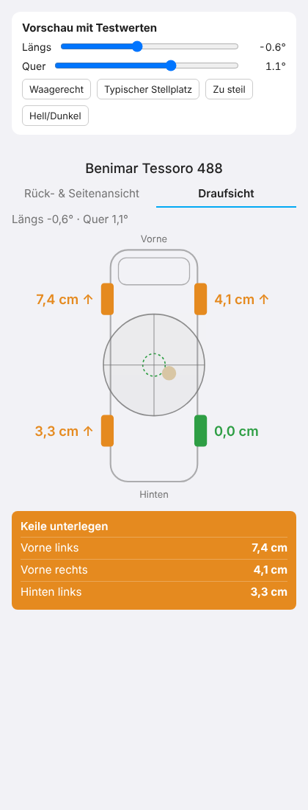
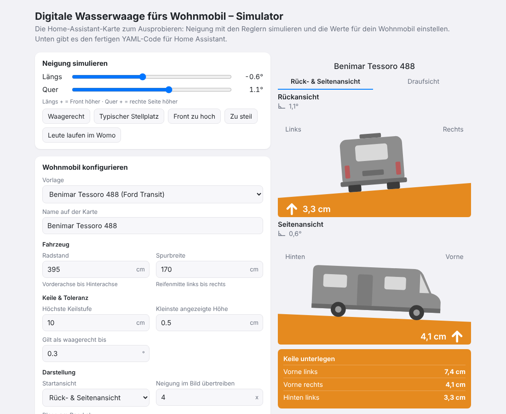

# Digital Spirit Level for the Motorhome – Home Assistant

[🇩🇪 Deutsch](README.md) · 🇬🇧 English

A custom Lovelace card for Home Assistant that shows how tilted the motorhome is
and **how many centimeters of leveling ramp go under which wheel**.

Vehicle: Benimar Tessoro 488 (Ford Transit, wheelbase 395 cm) – all values can be set for any motorhome.

> The card's labels are in German.

| Rear & side view | Top view |
|---|---|
|  |  |

## Features

- **Rear view** (roll) and **side view** (pitch): the ground tilts along, with centimeters and an arrow on the low side
- **Top view**: ramp height for each of the four wheels plus a bubble level
- "Place ramps" list, sorted by height
- Colors: green = level, orange = ramps needed, red = higher than your ramps can go
- "Raise only" (leveling with ramps)
- **Configure vehicle values** directly in the Home Assistant card editor
- **[Simulator website](https://tbr-brd.github.io/digitale-wasserwaage-wohnmobil-homeassistant/simulator/)** to try it without hardware

## Simulator

👉 **[Try the simulator online](https://tbr-brd.github.io/digitale-wasserwaage-wohnmobil-homeassistant/simulator/)**

Runs entirely in the browser, even offline: download and open [`simulator/index.html`](simulator/index.html).

- Simulate tilt with sliders, including "people walking around in the motorhome" (wobble)
- Configure your motorhome: wheelbase, track width, highest ramp step, tolerance, display
- "Benimar Tessoro 488" preset or your own values, saved in the browser
- Generates the ready-to-use **YAML code** for the card to copy



## Configuration

The card has a visual editor (Edit dashboard → card → Edit).
Alternatively via YAML:

```yaml
type: custom:womo-level-card
title: Benimar Tessoro 488
pitch_entity: sensor.womo_level_neigung_laengs   # + = front higher
roll_entity: sensor.womo_level_neigung_quer      # + = right side higher
wheelbase: 395      # cm, wheelbase
track: 170          # cm, track width – still to be measured
max_wedge: 10       # cm, highest ramp step
min_lift: 0.5       # cm, ignore smaller values
tolerance: 0.3      # degrees, counts as level
default_view: overview   # overview | top
exaggerate: 4       # exaggerate the tilt in the drawing
bubble_range: 3     # degrees until the bubble reaches the edge
invert_pitch: false
invert_roll: false
```

| Option | Meaning | Default |
|---|---|---|
| `wheelbase` | Distance from front to rear axle | 395 cm |
| `track` | Track width, center of left tire to right | 170 cm |
| `max_wedge` | Highest step of your own ramps – anything above turns red | 10 cm |
| `min_lift` | Smaller ramp heights are shown as 0 | 0.5 cm |
| `tolerance` | Up to this angle the motorhome counts as level | 0.3° |
| `default_view` | Start view | overview |
| `exaggerate` | How strongly the tilt is exaggerated in the drawing | 4x |
| `bubble_range` | Angle at which the bubble reaches the edge | 3° |
| `invert_pitch` / `invert_roll` | Flip the sign if the sensor is mounted the other way round | off |

## Development

`womo-level-card.js` is the card. After changes, rebuild the simulator:

```bash
python3 build_simulator.py
```

## Status

- [x] Dashboard card with settings editor
- [x] Simulator website with vehicle configuration
- [ ] Sensor: integration of the **Xparkle RVS01** via the Raspberry Pi 4's Bluetooth – see [plan](docs/xparkle-integration.md) (German)
- [ ] Alternative without a bought device: ESPHome configuration (ESP32 + MPU6050, calibration button)
- [ ] Installation guide

## More projects

🌐 Overview of all projects: **[lets-make.de](https://www.lets-make.de)**

### 🚐 Motorhome & Home Assistant
| Project | What it does |
|---|---|
| [wohnmobil-touren-homeassistant](https://github.com/TBR-BRD/wohnmobil-touren-homeassistant) | Motorhome trips from GPS data on a map |
| [gewitterwarner-gw1-shelly-uni-homeassistant](https://github.com/TBR-BRD/gewitterwarner-gw1-shelly-uni-homeassistant) | Thunderstorm warner via Shelly UNI |
| [ha-action-32x32-led](https://github.com/TBR-BRD/ha-action-32x32-led) | 32x32 BLE LED panel as an info display |

### 📟 ESP32 displays
| Project | What it does |
|---|---|
| [ha-round-pv-weather-display](https://github.com/TBR-BRD/ha-round-pv-weather-display) | Round ESP32 display for PV, battery and weather |
| [esp32-cyd-wetterdisplay](https://github.com/TBR-BRD/esp32-cyd-wetterdisplay) | Weather display with forecast on the ESP32 "Cheap Yellow Display" |

### ☀️ Solar & energy
| Project | What it does |
|---|---|
| [bkw-effizienz-steigern](https://github.com/TBR-BRD/bkw-effizienz-steigern) | More efficient balcony power plant with battery and two inverters |
| [homeassistant-stromzaehler](https://github.com/TBR-BRD/homeassistant-stromzaehler) | Grid draw, feed-in and PV generation via a Tasmota meter reader |
| [pv-bitcoin-miner](https://github.com/TBR-BRD/pv-bitcoin-miner) | Bitcoin mining with surplus PV, controlled by a Shelly Pro 3EM |

All projects: [github.com/TBR-BRD](https://github.com/TBR-BRD)

<br>
<a href="https://www.buymeacoffee.com/thoralf.brandt" target="_blank">
  
</a>
